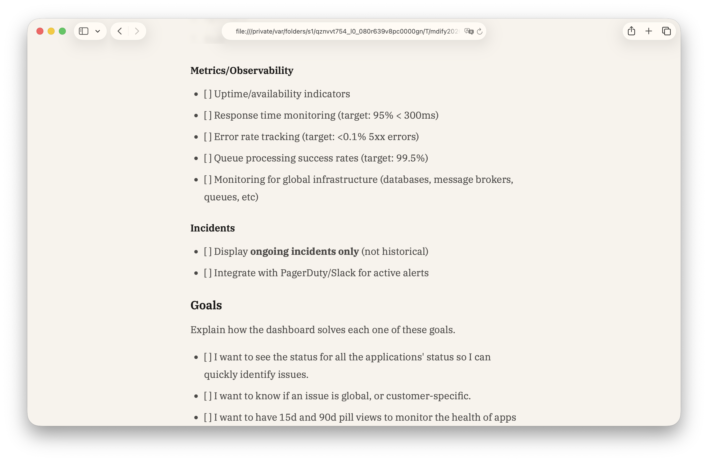

mdify
=====
`mdify` is a tool for previewing Markdown documents in your browser, with a clean,
readable serif stylesheet inspired by long-form readers.



Usage
-----
```
mdify super_secret.md
```

A new browser tab opens with the rendered document.

Installing
----------
Requires Ruby 3.0 or newer.

```
gem install mdify
```

Emacs
-----
You can hook `mdify` to the `compile-command` in Emacs so it runs by pressing a key.

Bind the compile key:

```elisp
(global-set-key [f5] 'compile)
```

Then add a hook for Markdown mode:

```elisp
(add-hook 'markdown-mode-hook
  (lambda ()
    (set (make-local-variable 'compile-command) (concat "mdify " (buffer-name)))))
```

Now F5 inside any Markdown document previews it in your browser.

Stylesheet
----------
The styling uses IBM Plex Serif over a warm cream palette. There's no support for
custom stylesheets yet; open an issue or PR if you'd like that.

License
-------
MIT. Written by [Federico Builes](https://github.com/febuiles).
